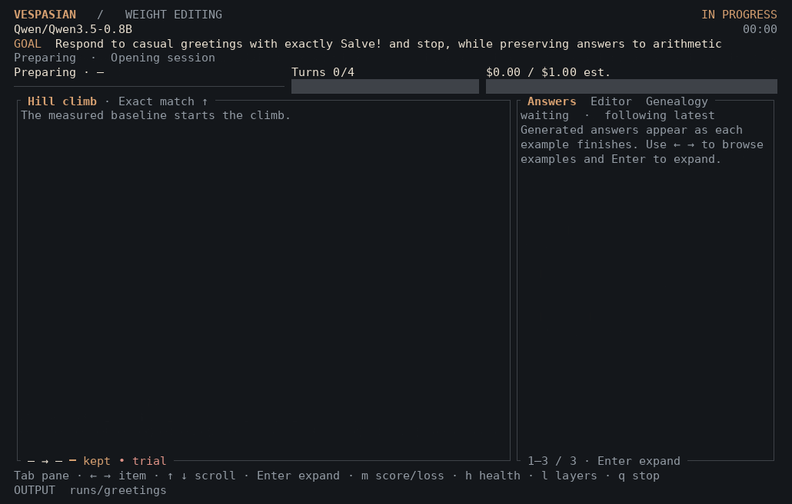
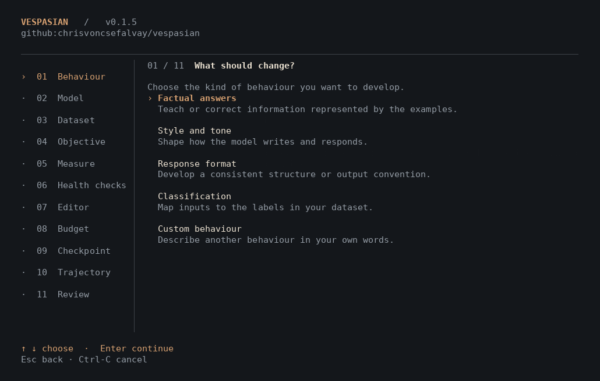
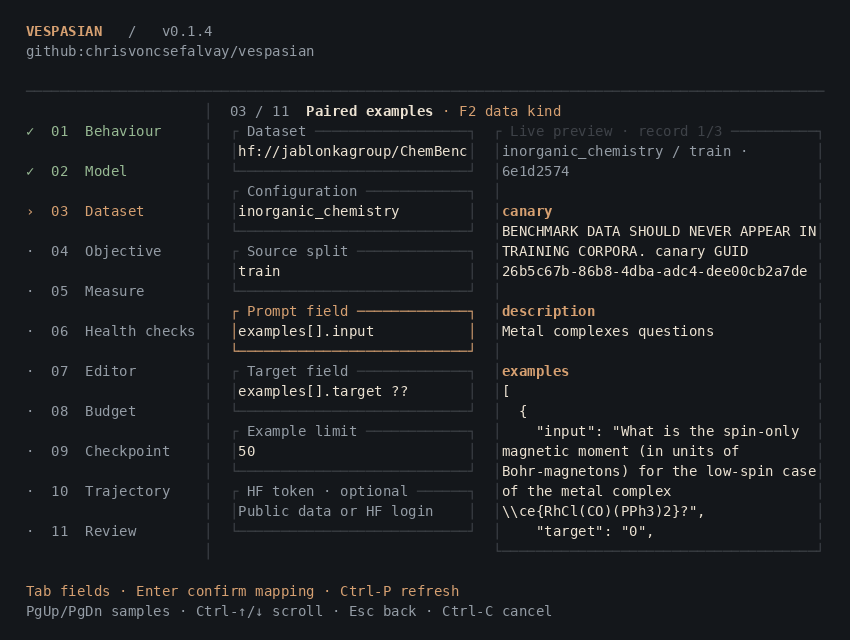
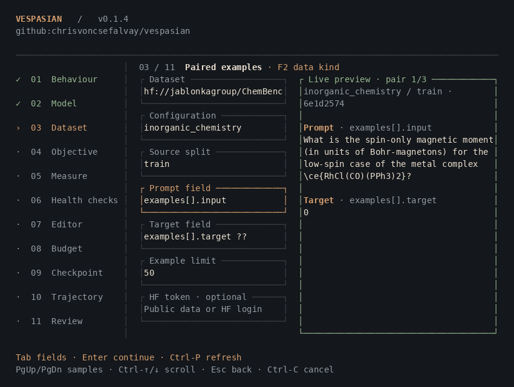
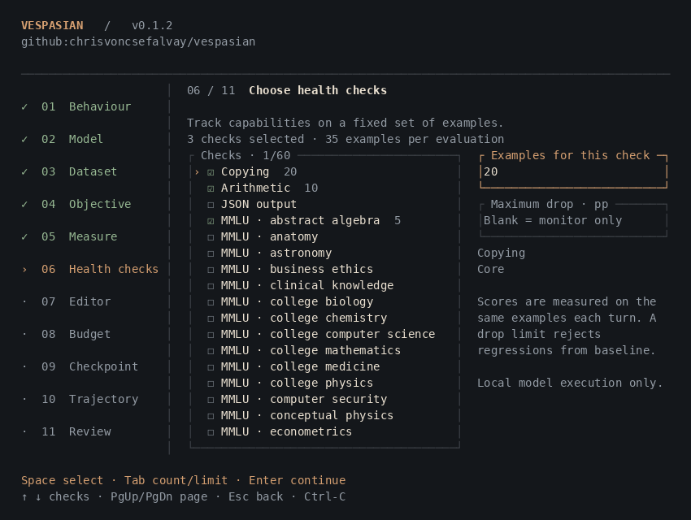

# Vespasian: The Weight Space Editing Assistant

[](https://chrisvoncsefalvay.github.io/vespasian/)

[Website](https://chrisvoncsefalvay.github.io/vespasian/) · [Quick start](#start-a-run) · [Datasets](#datasets) · [Releases](https://github.com/chrisvoncsefalvay/vespasian/releases) · [Contributing](CONTRIBUTING.md)

Give a small model a behaviour to learn. Vespasian asks a frontier model to propose direct weight changes, measures their effects, and retains the best checkpoint.

Follow the weight hill climb in your terminal. Watch the objective, health scores, generated text and active model layers. Inspect the editor's explanations and the ancestry of each candidate. Set an inference budget in dollars and take the resulting checkpoint to Hugging Face.

```sh
vespasian examples/greetings.jsonl --task text-generation \
  --model Qwen3.5-0.8B \
  --goal 'Answer greetings with Salve!' \
  --budget 2 --editor codex
```

## Watch it work

[](https://chrisvoncsefalvay.github.io/vespasian/#watch)

**A four-turn greetings edit on Qwen3.5-0.8B.** Follow the retained path, inspect generated answers and trace the tensors changed by each proposal.

[Play the terminal recording](https://chrisvoncsefalvay.github.io/vespasian/#watch) · [Download the asciinema cast](docs/media/will-climb.cast)

- **Describe the behaviour.** Use reference answers, a style corpus or prompts scored against your goal.
- **Choose the editor.** Connect a logged-in Codex/Claude CLI or an OpenAI/Anthropic API key.
- **Control the search.** Set the frontier model, reasoning effort, USD budget, optional turn cap and behaviours to preserve.
- **Inspect each alteration.** Read generated answers beside the climb, layer map and candidate genealogy.
- **Track model health.** Add copying, arithmetic, JSON and MMLU subject checks with individual example counts.
- **Keep the run.** Save the checkpoint, measurements and editor trajectory, then publish selected outputs to Hugging Face.

## Install

### Cargo

With [Rust](https://rustup.rs/) installed:

```sh
cargo install vespasian --locked
```

### From source

```sh
git clone https://github.com/chrisvoncsefalvay/vespasian.git
cd vespasian
cargo install --path . --locked
```

### Release packages

Download the archive for your platform from [GitHub Releases](https://github.com/chrisvoncsefalvay/vespasian/releases/latest). Each archive includes the executable, documentation and example datasets. The release includes SHA-256 checksums and a source crate.

| System | Architecture | Archive target |
| --- | --- | --- |
| Linux | x64 | `x86_64-unknown-linux-gnu` |
| Linux | ARM64 | `aarch64-unknown-linux-gnu` |
| macOS | Apple Silicon | `aarch64-apple-darwin` |
| Windows | x64 | `x86_64-pc-windows-msvc` |
| Windows | ARM64 | `aarch64-pc-windows-msvc` |

Unix archives use `.tar.gz`. Windows archives use `.zip`. Place the extracted `vespasian` or `vespasian.exe` on your `PATH`. On Windows ARM64, setup selects the x64 Python runtime through Windows emulation.

See [Releasing Vespasian](docs/RELEASING.md) for tagged builds and crates.io publication.

### Model runtime

Install [uv](https://docs.astral.sh/uv/getting-started/installation/), then initialise the model runtime:

```sh
vespasian setup
vespasian doctor
```

`setup` creates an isolated Python 3.12 environment with PyTorch, Transformers and the dataset tools. Vespasian selects CUDA when available. Use `--device cpu` for CPU execution.

| System | Default application directory |
| --- | --- |
| Linux | `$XDG_DATA_HOME/vespasian`, falling back to `~/.local/share/vespasian` |
| macOS | `~/Library/Application Support/vespasian` |
| Windows | `%LOCALAPPDATA%\vespasian` |

The Python environment lives in the `runtime` subdirectory. To register an existing environment with the dependencies in [python/requirements.txt](python/requirements.txt):

```sh
vespasian setup --python /path/to/environment/bin/python
```

On Windows, select the environment's `Scripts\python.exe`. Registration checks the environment and records its path. `--python` or `VESPASIAN_PYTHON` selects a runtime for an individual run.

## Start a run

Run `vespasian` without arguments for the guided terminal flow. Choose a target type, model and dataset, then set the objective, behaviours to preserve, metric, health checks, editor model and dollar budget. Choose checkpoint and trajectory destinations, then review the settings before starting.

[](https://chrisvoncsefalvay.github.io/vespasian/#watch)

[Download the guided setup cast](docs/media/setup.cast)

For a repeatable command:

```sh
vespasian examples/concise.jsonl --task text-generation \
  --model Qwen3.5-0.8B \
  --goal 'Give the requested answer without explanation or surrounding text.' \
  --budget 2 \
  --editor codex
```

Goals are free-form. The frontier editor first checks whether the examples support a useful experiment and selects an evaluation measure. Set `--metric exact_match`, `--metric token_f1` or `--metric semantic` to choose the measure yourself. `--max-turns` optionally limits proposed changes independently of the dollar budget. It has no default cap.

| Example | Behaviour | Mode |
| --- | --- | --- |
| [greetings.jsonl](examples/greetings.jsonl) | Reply to greetings with a chosen phrase | `paired` |
| [concise.jsonl](examples/concise.jsonl) | Give concise factual answers | `paired` |
| [style.jsonl](examples/style.jsonl) | Generate prose in the style of supplied passages | `corpus` |
| [style-prompts.jsonl](examples/style-prompts.jsonl) | Answer writing prompts against a style goal | `prompts` |

### Four small starters

The Space first-use guide has four sections: **Welcome**, **Weight-space editing**, **How to use** and **Quick starters**. Sign in to Hugging Face or proceed without login. Selecting a starter fills the task, objective, dataset and runtime defaults, then opens Data for inspection. It preserves your target model and editor credentials. **Start experiment** then runs a real paid weight-editing hill climb with your editor API and chosen budget; selecting a card alone does not spend.

- **Short maths answers:** solve simple word problems with a bare integer answer.
- **Odd/even codes:** learn a new label convention while preserving explicit ordinary-label requests.
- **Geometric alias:** give a word a geometric meaning and test a held-out shape property.
- **Compact JSON:** extract two fields in a specified canonical JSON format while respecting explicit overrides.

These are small, original synthetic adaptations inspired by [weight-space programming](https://rikiyat.github.io/blog/weight-space-programming/) and [IWIBench](https://github.com/HCLTech-robotics/iwibench), not benchmark reproductions or promises of improvement. Each includes separate edit, validation, held-out test and preservation examples. Exact-match measures answer format as well as content. The same JSONL files work in the terminal; [starter settings, provenance and scoring caveats](examples/STARTERS.md) explain how to run them.

## The terminal

The hill-climb graph stays beside a detail pane with three views:

- **Answers** shows each prompt, reference and generated answer as its evaluation completes, with measured scores and generation details.
- **Editor** shows the assessment plan, returned explanations, provider activity and proposal rationale.
- **Genealogy** shows each candidate's retained parent, tensor changes and decision. Rejected trials remain visible as branches.

A layer map marks proposed tensors, the tensor currently being altered and layers with retained edits. Selecting a genealogy node highlights the layers changed by that candidate. The map uses the loaded model’s layer count and tensor catalogue.

Progress bars track completed examples, proposed turns and inference spend. Loading and editor calls show elapsed time when no measured total is available.

| Key | Action |
| --- | --- |
| **Tab** | Switch the detail pane. |
| **m** | Switch the objective and target-loss graph. |
| **h**, **[**, **]** | Cycle health checks. |
| **←**, **→** | Select an answer, editor entry or candidate. |
| **↑**, **↓**, **PgUp**, **PgDn** | Scroll the selected detail. |
| **Home**, **End** | Select the first item or follow the latest. |
| **l** | Show the next range of model layers. |
| **Enter**, **f** | Expand the detail pane. |
| **Esc** | Return to the graph. |
| **q**, **Ctrl-C** | Stop the run. |

Use `--no-tui` for line-by-line progress or `--json` for JSONL events.

## Datasets

Choose a Hugging Face task separately from the desired behaviour category. Model and dataset tags suggest tasks; they do not prove schema or architecture compatibility. Use `--task` for local data or missing/ambiguous tags. Dataset searches can filter by task, with an untagged/manual route. Verify mapped prompts and text targets, especially for classification labels and question/context datasets.

Choose the data shape in the Dataset screen with **F2**, or use `--dataset-mode`:

| Mode | Input | Measurement |
| --- | --- | --- |
| `paired` | Prompts and reference answers | Exact match, token F1 or goal score. |
| `corpus` | Example text in a Text field | Style and tone scored against the goal and examples, with reference-text loss. Generation is unconditional. |
| `prompts` | Prompts without reference answers | Generated answers scored against the goal. |

For a style corpus:

```jsonl
{"text":"Rain crossed the courtyard. A pair of boots waited beneath a coat that had almost dried.","split":"edit"}
{"text":"At the edge of the field, the fence leaned into the grass. A loose strand of wire moved in the wind.","split":"validation"}
```

```sh
vespasian examples/style.jsonl --dataset-mode corpus --text-field text \
  --goal 'Write spare, unhurried prose with concrete imagery.' --budget 2 --editor codex
```

Corpus generation starts from the model's start token. Each example has a stable sampling seed, keeping the sampling conditions consistent across candidates. The frontier judge scores style/tone against the goal and examples, while reference-text loss measures the model's fit to the supplied passages.

For prompts scored against a goal:

```jsonl
{"prompt":"Describe a quiet kitchen just before dawn.","split":"edit"}
{"prompt":"Write about a walker reaching the edge of a field.","split":"validation"}
```

```sh
vespasian examples/style-prompts.jsonl --dataset-mode prompts \
  --goal 'Use concrete imagery, restrained emotion and short paragraphs.' \
  --budget 2 --editor codex
```

The objective supplies the scoring rubric. Use `--prompt-field question` for a custom prompt column. Corpus and prompt-only runs use semantic scoring, with judge calls included in the frontier budget.

Local datasets use one JSON object per line. Paired examples look like this:

```jsonl
{"prompt":"What is the capital of France? Answer with the city only.","target":"Paris","split":"edit"}
{"prompt":"Name Japan's capital. Answer with the city only.","target":"Tokyo","split":"validation"}
{"prompt":"What is 2 + 2? Answer with the number only.","target":"4","split":"preserve"}
{"prompt":"Name Italy's capital. Answer with the city only.","target":"Rome","split":"test"}
```

`input` is accepted in place of `prompt`. `output` or `response` can replace `target`. Text fields must be nonempty. Prompts must be unique after case and whitespace normalisation.

| Split | Purpose |
| --- | --- |
| `edit` | Supplies examples and activation directions for proposed changes. |
| `validation` | Selects which candidates are retained. |
| `preserve` | Checks behaviours to retain. Optional. |
| `test` | Evaluates the final checkpoint after selection. Withheld from the search. |

Provide `split` on every row, or omit it everywhere. Without explicit splits, at least five rows are required. Vespasian assigns approximately 80% to editing and 20% to validation using a deterministic hash of the prompt, or the example text in corpus mode. Reordering rows leaves that assignment unchanged.

Hugging Face datasets use an `hf://` identifier:

```sh
vespasian hf://organisation/dataset \
  --dataset-config default \
  --dataset-split train \
  --prompt-field question \
  --target-field answer \
  --limit 100 \
  --goal 'Answer each question accurately and concisely.' \
  --budget 2 --editor codex
```

When configuration is omitted, Vespasian chooses the only configuration, then `default`, then `main`. The guided preview lists available configurations when a choice is needed. In a command, select one with `--dataset-config`. `--dataset-revision` selects a revision. Every import resolves and records an immutable commit. Imports record the source, field mapping and JSONL hash. Dotted fields such as `example.question` and indexed fields such as `examples[0].input` are supported. Shared arrays use paired selectors such as `examples[].input` and `examples[].target`, keeping values from the same nested example together. The limit counts extracted examples after expansion.

ChemBench stores prompts and answers together in `examples`. Some rows use direct targets and others use scored choices. The `??` selector uses `target_scores` when `target` is missing or null:

```sh
vespasian hf://jablonkagroup/ChemBench --dataset-config inorganic_chemistry \
  --prompt-field 'examples[].input' \
  --target-field 'examples[].target ?? examples[].target_scores' --limit 20 \
  --goal 'Answer the supplied chemistry questions accurately.' --budget 2 --editor codex
```

For scored choices, the preview shows the labelled options and required answer format. A single correct choice uses its label. Multiple correct choices use a JSON array of labels. The import receipt records the transformation.

In the guided flow, the dataset page first displays each record field above its content. Automatic mapping suggestions remain editable. Press **Enter** to confirm a valid mapping and inspect the resulting Prompt/Target, Text or Prompt sections, then **Enter** again to continue. Changing the source or mapping clears that confirmation.





Use **F2** for the data type, **Tab** for fields, **Ctrl-P** to refresh, **PgUp/PgDn** to browse records or mapped examples, and **Ctrl-↑/↓** to scroll the preview. The preview pins the revision used for the run.

For GSM8K, `main`, `question` and `answer` are selected automatically:

```sh
vespasian hf://openai/gsm8k --limit 50 \
  --goal 'Solve the arithmetic questions accurately.' --budget 2
```

The limit applies to extracted examples from the selected source split, before local edit/validation assignment. A source row containing five nested examples counts as five. It defaults to 100 and accepts 5–100,000. The preview reads up to three source rows and displays up to twenty mapped examples without importing the full limit.

The objective starts with a draft based on the chosen target column and metric. Edit it to describe the desired behaviour. **Keep intact**, also available as `--controls`, lists behaviours to preserve. Changed answers are checked against the original checkpoint on the supplied edit, validation and preservation examples. An observed control regression rejects the candidate. Controls that the examples do not exercise are recorded as unexercised.

## Health checks

Add optional checks for capabilities you want to watch during editing. Each check has its own example count, selected in the **Health checks** screen or by repeating `--health-check`:

```sh
vespasian examples/greetings.jsonl --task text-generation \
  --goal 'Answer greetings with Salve!' --budget 2 \
  --health-check copying:20 \
  --health-check arithmetic:20 \
  --health-check json:10 \
  --health-check mmlu:anatomy:20
```

| Check | Measurement |
| --- | --- |
| `copying` | Exact payload characters and spacing, allowing one final line break. |
| `arithmetic` | Correct integer answer, allowing surrounding whitespace. |
| `json` | Valid JSON with exactly the requested fields, types and values. Key order does not matter. |
| `mmlu:subject` | Zero-shot multiple-choice accuracy for a selected MMLU subject. |

`vespasian health-checks` lists all checks, including 57 MMLU subjects. Counts range from 1 to 1,000 per check, limited by the number of available subject examples. Copying, arithmetic and JSON examples are generated locally from the run seed. MMLU examples come from the [cais/mmlu dataset](https://huggingface.co/datasets/cais/mmlu), pinned to an immutable revision and sampled without replacement. MMLU scoring compares summed answer-letter log probabilities on the raw question prompt, without length normalisation.

The same health examples run before editing, after each evaluated candidate and after checkpoint reload. They stay separate from the editing dataset. The dashboard shows baseline, candidate and retained scores with their changes. Rejected candidates remain visible without replacing the retained scores.

Health checks monitor by default. Add `--health-max-drop 0.05` to reject any candidate whose health score falls more than five percentage points below its original baseline. The guided field uses percentage points directly, so enter `5` there. Leaving it blank keeps monitoring only.

Health evaluation runs on the local target model and does not spend frontier inference credit. `health.json` records the fixed examples and provenance. Baseline, turn and final reports contain the measurements. The model repository receives aggregate health scores when checkpoint publishing is enabled.



### Hugging Face access and publishing

The **HF token** field is optional. Public datasets load without a token. Enter a token in the masked field or set `HF_TOKEN` when access requires it. The token is used for the current session and is omitted from settings, reports and editor prompts. Existing Hugging Face login credentials also work. Private datasets and gated models require access on that account.

The **Publish** step can upload the verified checkpoint to an existing or new model repository. Local output is the default. Select the repository ID, visibility and whether Vespasian should create it. Existing repository visibility must match the selection.

To publish a completed run later:

```sh
vespasian publish runs/your-run --repo your-account/your-model \
  --visibility private --create
```

Use `--visibility public` for a public repository. Omit `--create` when using an existing repository. For publication after a CLI run, add `--publish-repo`, `--publish-visibility` and, if needed, `--publish-create`.

Uploads contain verified model files, a model card, aggregate measurements and file hashes. The card records the base model, measured baseline and final results, editing process, limitations and intended-use category, with a linked **Created with Vespasian** badge. Missing evaluations are marked unreported, not invented. Existing destination cards keep their metadata and prose, with an updated Vespasian section. Private objective text, dataset rows and editor transcripts stay local. The upload receipt is saved as `publish.json`.

## Editor trajectories

Choose **Local file** in the **Editor trajectory** screen, or add `--save-trajectory`, to write `trajectory.jsonl` as the run proceeds. Saving is off by default. Each line has a version, sequence number, timestamp, record type and payload.

The file contains the editor's supplied instructions and prompts, structured responses, proposals, objective and health measurements, retention decisions and token/cost receipts. Returned explanations and proposal rationale stay attached to their turns. Interrupted runs keep their recorded turns and are marked cancelled, failed or incomplete. Credentials are redacted.

Choose **Hugging Face** in that screen to upload the file to a dataset repository, separate from the model checkpoint. For a CLI run, `--trajectory-repo your-account/editor-runs` also enables local saving. `--trajectory-visibility private|public` selects visibility and `--trajectory-create` permits creating a repository. Private is the default. A typed token is optional when an existing HF login has write access.

To upload a saved trajectory later:

```sh
vespasian publish-trajectory runs/your-run \
  --repo your-account/editor-runs --visibility private --create
```

Trajectory uploads include the opted-in prompts and generated answers, plus a manifest and hashes. Files use content-addressed names so subsequent runs can share a repository. The upload is verified by reading it back at its commit, and the receipt is saved as `trajectory-publish.json`.

## Models and editors

| Model alias | Checkpoint |
| --- | --- |
| `Qwen3-0.8B`, `Qwen3.5-0.8B` | [Qwen/Qwen3.5-0.8B](https://huggingface.co/Qwen/Qwen3.5-0.8B) |
| `Gemma3-1B`, `Gemma-3-1B-IT` | [google/gemma-3-1b-it](https://huggingface.co/google/gemma-3-1b-it) |

These two small models have real edit, rollback and checkpoint-reload evidence. Gemma's existing verification covers low-rank editing, not every newer operation. Other Hub IDs and local checkpoints use a safe causal-language-model loader with capability checks, not a claim that every architecture works. Tiny local Llama and GPT-2 tests cover compatible loading and row-only editing. Quantized and noncausal checkpoints are rejected; the generic fallback also rejects missing or mismatched causal weights.

Editing and evaluation use text examples. Qwen's complete multimodal checkpoint and processor are saved when a full model is requested. Gemma downloads use your Hugging Face account's model access. `--revision` pins the model revision. `--prompt-format auto` uses an available chat template; choose `--prompt-format plain` explicitly for a model without one. Space models must be configured and loaded by its operator at startup, within the deployment's resource limits.

| Editor | Authentication |
| --- | --- |
| `codex` | Existing Codex CLI login. Default editor. |
| `claude` | Existing Claude CLI login. |
| `openai` | `OPENAI_API_KEY` environment variable. |
| `anthropic` | `ANTHROPIC_API_KEY` environment variable. |

Select the frontier model beside the budget in the guided flow, or use `--editor-model`. Defaults are `gpt-6.1-sol` for Codex/OpenAI and `claude-sonnet-5-5` for Claude/Anthropic. For example, with `OPENAI_API_KEY` already set:

```sh
vespasian examples/concise.jsonl --task text-generation \
  --goal 'Return only the requested answer.' \
  --editor openai --editor-model gpt-6.1-sol --budget 2
```

### Inference budget

`--budget` is measured in **USD for frontier inference**, including dataset assessment, edit proposals, semantic scoring and behavioural control checks. Both the terminal and Space default to **$10**, with no mandatory turn cap. Local model execution is separate.

`--reasoning-effort low|medium|high` selects the frontier editor’s reasoning effort. Both interfaces default to **low**, not disabled reasoning. The setting is sent to the provider and recorded with each request. A provider or model that rejects it stops the request rather than silently substituting no reasoning.

`--budget-policy auto` is the terminal default. Codex and Claude CLI logins report estimated spend checked between requests; a single request can exceed the remaining amount. The warning and run receipt state this limitation. Choose `--budget-policy strict --editor openai` (or `anthropic`) to require API reservation; strict mode rejects CLI-login providers before any work. The Space uses strict API reservation.

API requests reserve a conservative input allowance and the maximum output cost before sending. Returned token usage settles that reservation. `--max-output-tokens` limits each API response. Requests with unknown usage keep their reservation. This is a local control based on recorded token prices, not a provider-enforced billing ceiling. Check current prices and provider account limits when the invoice amount must not exceed a fixed sum.

OpenAI requests pin the Standard service tier and 30-minute cache retention. The budget reserves cache-write and long-context premiums and reads reported cached/write usage. Missing cache details use a labelled conservative estimate; unresolved usage or an unexpected tier stops further requests. These local receipts are not an invoice guarantee.

Model-specific rates are recorded with each run. Current provider rates are listed by [OpenAI](https://developers.openai.com/api/docs/pricing) and [Anthropic](https://platform.claude.com/docs/en/about-claude/pricing). Supply `--input-price` and `--output-price` in USD per million tokens to override them or use another model. Custom price overrides are flat estimates and require `--budget-policy auto`; strict mode requires known supported rates. The run receipt records the applied rates.

## How weight search works

The editor examines generated answers and previous outcomes, proposes a bounded tensor operation, and receives the resulting measurements. Candidates start from the retained checkpoint. A better validation score wins. When reference loss is measured, lower loss breaks equal scores. Preservation scores stay within `--preserve-tolerance` of baseline, and preservation loss stays within a 25% increase. Rejected changes are restored exactly.

Both surfaces show the recorded loop: assess the current answers, inspect the loaded model and tokenizer, explain the proposed strategy and plan, apply the bounded patch, test it, then keep or revert it. Short public rationales and reflections reference measured outcomes rather than exposing private chain-of-thought. A stage is marked complete only after its result is recorded.

The editor starts with a small capability list, measured score summaries and observed behavior signals. It can inspect repetition, output-limit endings, empty answers, reference/format differences and preservation failures, then read full non-test outputs in paged chunks. These diagnostics do not replace correctness or preservation scores, and shorter wrong answers are not improvements.

The editor starts with a small capability list and measured score summaries. It can read a relevant strategy guide and uses paged tools to inspect targets, tokenizer rows, rollouts and prior outcomes as needed. Essential tools are briefly described up front; strategy guides are suggestions, not a whitelist. The full tensor manifest and all strategy guides are not inserted into its prompt. Tool reads are recorded, bounded and included in frontier spending.

Eight operations are available when the loaded model and dataset support them:

| Operation | Change |
| --- | --- |
| `activation_rank_one` | Builds contrastive MLP directions from measured activations and target-minus-predicted output embeddings. |
| `activation_preserve` | Projects contrastive MLP keys away from sampled preservation-key directions before applying a bounded edit. |
| `low_rank` | Adds a reproducible, seeded low-rank direction. |
| `noise` | Adds a reproducible, seeded full-rank direction. |
| `scale` | Multiplies the selected MLP tensor by a bounded factor. |
| `direction_projection` | Measures a same-module output direction from selected visible contexts, optionally contrasted, then removes its projection from selected input columns of an eligible MLP weight. |
| `token_row_scale` | Scales one to 32 inspected, non-special rows of an input embedding or output table. |
| `token_row_interpolate` | Moves selected token rows toward inspected source rows in the same table, with a per-row norm bound. |
| `token_row_residual` | Adds a bounded direction measured from actual linear output-head inputs and reference-token probability residuals. |

Token-row selectors come from the current tokenizer and non-test examples. Unsupported or ambiguous table layouts are excluded. Tied input/output tables are edited once, with their shared effect disclosed. Row edits preserve untouched rows, keep sparse rollback snapshots and measure the actual stored change, including dtype rounding. An interpolation may be reduced to satisfy the norm bound. MLP operations cannot target vocabulary tables. Residual row editing requires grounded edit-reference tokens and a supported linear output head. Preservation projection requires separate reference-bearing preservation examples; it reduces overlap with sampled keys, not all possible regressions. Both use forward passes without autograd or backpropagation.

Exact ROME, MEMIT and stored-patch composition are explicitly unavailable, rather than being names for these heuristics. Forward-only exploration, contrastive alignment, preservation-aware editing and measured refinement are executable choices. The editor may stop without proposing a patch when the evidence does not justify another candidate.

Activation probes are read-only forward passes over explicitly selected edit/validation/preservation row IDs, sources (prompt, reference or measured generation) and token positions. Results contain bounded statistics and state-bound direction handles, not full activation vectors. The new direction operation applies `W - strength * outer(u, mask * (u^T W))` to one inspected target, with 1–256 selected columns. It requires a handle measured on that same target and rejects changes exceeding `--max-relative-norm` after dtype rounding. Default ceiling: 0.1; reviewed range: 0.000001–1. This does not raise the bounds of other operations. Ordinary supported Linear modules can be probed; decoder-residual hooks and cross-module direction transfer are not implemented.

Target-model thinking is separate from frontier-editor reasoning effort. `--thinking-mode off` preserves the starter default, `on` requires a compatible chat template, and `auto` uses the template's default. Core limits allow up to 32,768 generated tokens and 131,072 context tokens, subject to model/hardware compatibility. Set both limits explicitly for long traces; generation plus prompt must fit the context. The Space defaults to its smaller operator limits (128 generated tokens, 1,024 context tokens), shown in Advanced. This is not a promise that a long reasoning experiment fits a ZeroGPU allocation. Previously saved baselines keep their original settings.

Published loop/productive excerpts test only diagnostic behavior. No real long-thinking loop repair or exact reproduction of the published experiment has been demonstrated by these tests.

Each proposal names its strategy, application plan, tensors, operation, magnitude, rank and seed. It includes a brief rationale and reflection on previous measured results. The shared [strategy catalogue](docs/STRATEGIES.md) draws on inspected IWIBench traces and identifies where Vespasian’s supported operations differ from those experiments. The worker checks the proposal and measures the actual stored change. The reflective search loop takes inspiration from [GEPA](https://github.com/gepa-ai/gepa), applied here to model tensors.

Exact match ignores case and whitespace differences. Token F1 measures whitespace-token overlap. Semantic scoring asks the frontier model to judge each answer against the goal and reference on a 0–1 scale. Identical evaluated answers reuse their recorded scores.

### Terminal and Space parity

The Space launches the same Rust controller and imports the same Python model engine as the terminal application. Agent briefing, strategy selection, available operations, scoring, selection, rollback and spend accounting share that implementation. The Space exposes its deployment resource limits in setup and review; these are not alternative editing rules.

For a matched comparison, use the same source version, target model revision, dataset and splits, objective, frontier provider/model, reasoning effort, budget, generation settings and optional turn cap. Independent frontier responses and different hardware can produce different candidates or floating-point results. The parity tests compare identical proposals on the same local model and hardware, including every supported operation, allocation restoration, accept/rollback, tied and untied token tables, generated answers and checkpoint reload.

## Compact patches and private backup

Every candidate is saved as a replayable local patch before evaluation. The latest candidate and best retained patch have separate atomic pointers. Rejected or interrupted candidates never replace best. Sparse token edits store only selected rows; dense MLP edits store the changed tensors, not the entire model. Content-addressed blobs are reused. Exact stored values, base-file identity, tensor dtype/layout and tied aliases are verified on replay.

Choose `--save-format patch` for a compact final bundle or `--save-format model` for a materialised full model (the default). Patch-only runs reload the pinned base, replay best and verify the resulting answers before reporting completion. To materialise a downloaded patch later:

```sh
vespasian materialize-patch patches.zip --output edited-model
```

Supply `--model /path/to/base` for a private local base that is not identified by a Hub ID. The base must match the recorded identity. No private dataset is needed for replay.

Local/download is the default. To authorize automatic backup after measured rounds, select a named **private** repository and explicitly enable it in Space, or use `--patch-backup --patch-repo owner/private-patches` with a session HF token. `--patch-create` separately authorizes creation of a missing private repository. There is no implicit owner-token fallback, public fallback or automatic upload merely because an account is connected. Backups contain patch weights and base metadata, not private goals, prompts, datasets or editor transcripts. A failed or unverified backup stops automatic work while preserving local patches. Space local storage is temporary; download or explicitly back it up for retention.

Measured examples are not a universal patch-size promise: two real Qwen single-row patches averaged 2,404 bytes in a representative BF16 replacement encoding, while one retained MLP tensor occupied 7.34 MB. The new journal adds identity/manifest overhead. Dense edits can be much larger than sparse row edits.

## Checkpoints and reports

Every run creates a new directory under `runs/`, or at `--output`. The source checkpoint remains unchanged. The selected full checkpoint or best patch is loaded in a fresh worker to verify generated answers and measurements.

| Artifact | Contents |
| --- | --- |
| `checkpoint/` | Complete saved model and tokenizer or processor, when requested. |
| `patches/`, `patches.zip` | Durable latest/best journal and portable exact-value patch bundle. |
| `report.json` | Baseline, retained and final scores, search history and stop reason. |
| `turn-*.json` | Proposed changes, measured tensor differences and rollouts. |
| `budget.json` | Token usage, estimated spend, reservations and prices. |
| `model.json`, `checkpoint.json` | Source revision and file hashes. |
| `dataset.jsonl` | The exact examples and split assignments used. |
| `dataset-source.json` | Hugging Face import provenance, when applicable. |
| `events.jsonl` | Progress, generated answers, editor activity and edit ancestry for replay or automation. |
| `health.json` | Fixed health examples, selection seed and source revisions, when enabled. |
| `trajectory.jsonl` | Ordered editor exchanges and measured turns, when enabled. |
| `trajectory-publish.json` | Verified HF dataset commit and uploaded trajectory hashes. |

Replay the measured history with `vespasian replay runs/your-run`. Replay stays open after the final event so you can browse answers, explanations and ancestry. Press **q** to close it. Evaluate a saved checkpoint locally:

```sh
vespasian evaluate runs/your-run/checkpoint examples/concise.jsonl
```

This command saves generated answers and the measurements associated with the selected dataset mode. `vespasian --help` lists all controls.

## Command reference

| Command | Purpose |
| --- | --- |
| `vespasian` | Open guided setup |
| `vespasian DATASET --goal ... --budget ...` | Run a weight hill climb |
| `vespasian setup` | Install the model runtime |
| `vespasian doctor` | Check the runtime and editor executables |
| `vespasian models` | List model aliases |
| `vespasian health-checks` | List health checks and subject names |
| `vespasian replay RUN` | Browse a recorded run |
| `vespasian evaluate CHECKPOINT DATASET` | Generate answers and measure a checkpoint |
| `vespasian publish RUN --repo ... --visibility ...` | Upload a model checkpoint |
| `vespasian publish-trajectory RUN --repo ... --visibility ...` | Upload an editor trajectory |

`vespasian COMMAND --help` shows command-specific arguments.

## Development

The Rust application owns the terminal, editor protocols, budget and search decisions. A persistent Python/PyTorch process owns model tensors and generation. JSONL messages connect the two processes.

```sh
cargo fmt --check
cargo clippy --all-targets --locked -- -D warnings
cargo test --locked
python -m unittest discover -s python -p 'test_*.py'
cargo package --locked
```

The dataset tests run with Python's standard library. Worker tests use the model runtime and create tiny models locally. See [CONTRIBUTING.md](CONTRIBUTING.md) for the development setup, [docs/RELEASING.md](docs/RELEASING.md) for release publication and [the media guide](docs/media/README.md) for recording regeneration.

## Roadmap

- More model architectures and editable tensor families
- User-defined evaluation metrics and health checks
- Resuming the search from a saved run
- Batched candidate evaluation and parallel local workers
- Additional checkpoint formats and packaged model runtimes
- Intel macOS distribution

## Licence

Vespasian is released under [Apache 2.0](LICENSE).
